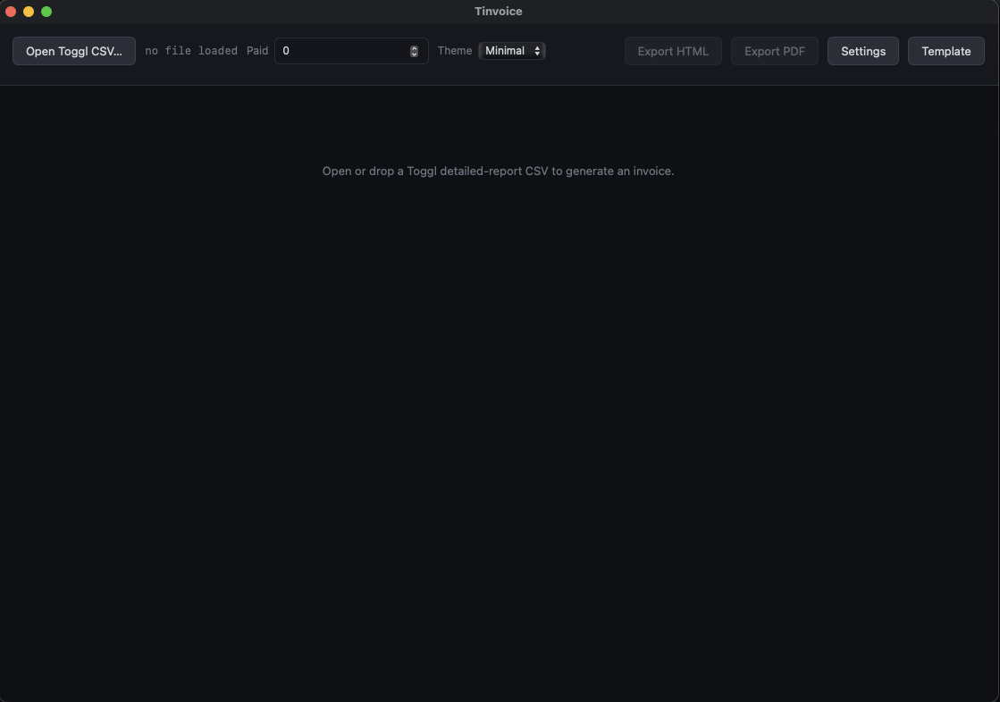

# tinvoice

Toggl Track CSV → invoice, as a tiny native desktop app.

Drop in a Toggl Track "detailed report" CSV export and get a rendered
invoice back — previewed live in the window, exported as HTML, or as a
vector PDF. No servers, no Electron: it's a [tinyjs](https://tinyjs.app)
app, a native macOS webview window backed by a txiki.js process.



## Features

- **Drag-and-drop or file picker** — drop a `.csv` onto the window or use
  the Open button.
- **Live invoice preview** — time entries are grouped by description,
  rounded per billing rules, and rendered instantly as you tweak the
  amount paid.
- **Export HTML or PDF** — PDF is a real vector export (native
  `printToPDF`, no headless browser).
- **Persisted settings** — your company info, client info, and hourly
  rate are saved between launches.
- **Custom HTML/CSS templates** — a built-in template editor lets you
  fully control the invoice's markup and styling (Handlebars-like
  `{{ }}` / `{{#each}}` syntax), on top of a few ready-made themes.

## Billing rounding

Time is summed per description, then rounded per billing period:

- under 12 minutes → 0.5h
- 12–42 minutes → rounded up to the next 0.5h
- over 42 minutes → rounded up to the next full hour

A flat $25 service fee is added to the total.

## Development

Requires [tinyjs](https://tinyjs.app) (`tinyjs new`, `tinyjs dev`, `tinyjs build`).

```sh
tinyjs dev      # run with hot reload
tinyjs build    # dist/tinvoice + dist/Tinvoice.app
```
